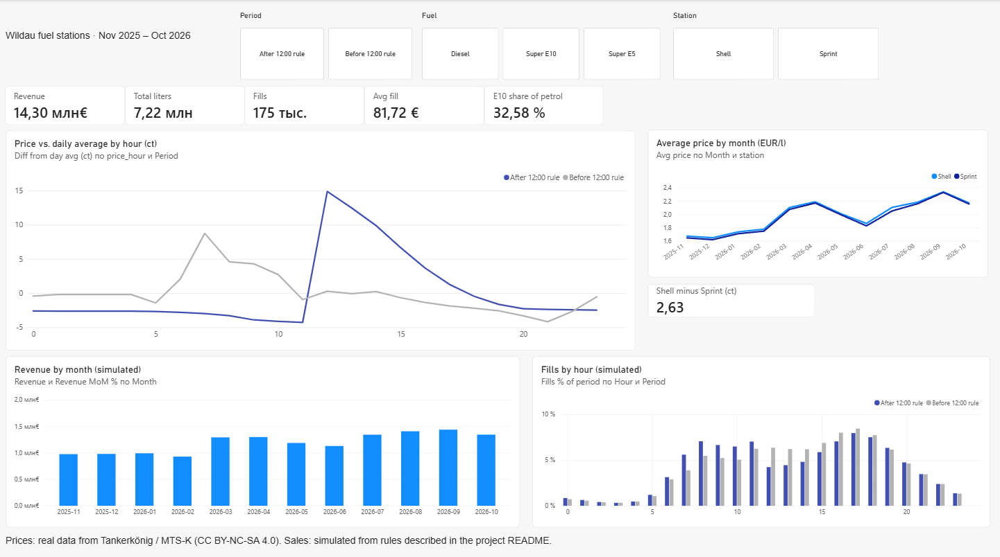
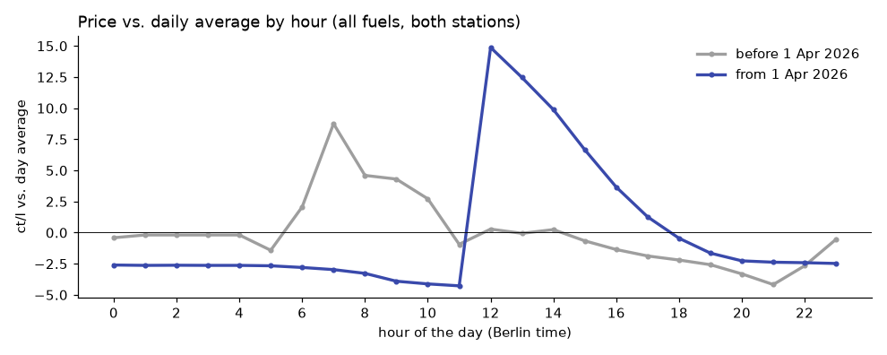
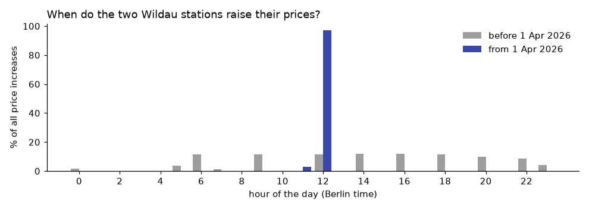
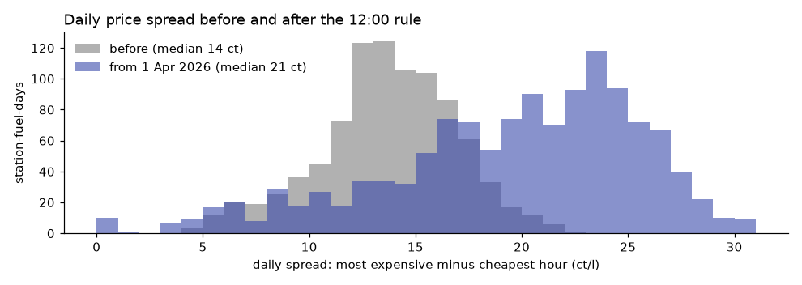
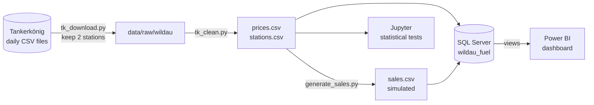
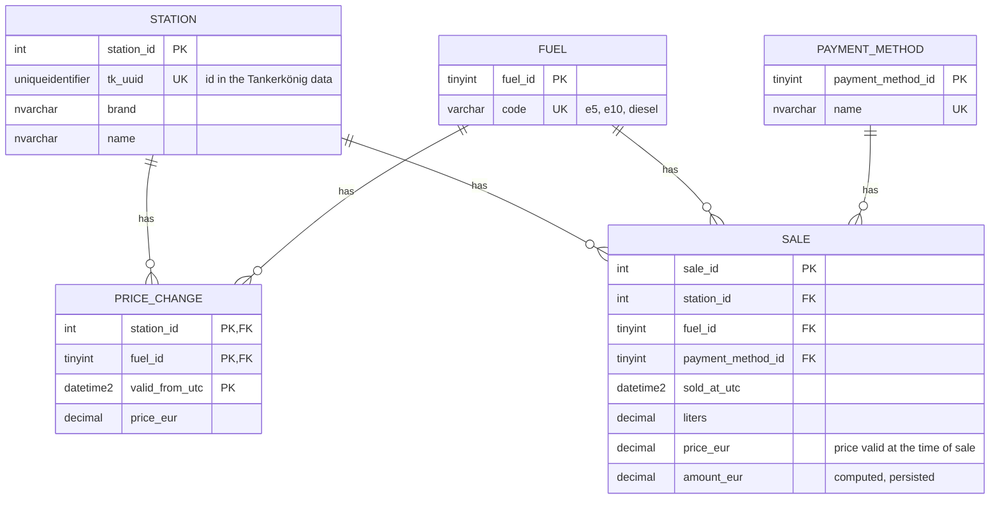

# Fuel prices in Wildau and the 12:00 rule

Since **1 April 2026** fuel stations in Germany may raise their prices only once a day, at 12:00.
This project uses one year of real price data (Nov 2025 – Oct 2026) from two stations in Wildau,
Brandenburg, to measure what the rule changed, and builds a SQL Server database and a Power BI
dashboard around it.



**Tools:** Python (pandas, SciPy), Microsoft SQL Server 2022 (T-SQL) in Docker, Power BI (DAX), Jupyter.

## Findings

At the two stations, the rule works as intended, but fuel did not get cheaper to time well.
The price gap between the most expensive and the cheapest hour of the day **grew by about half**.

| | Before 1 Apr 2026 | From 1 Apr 2026 |
|---|---|---|
| Price increases between 12:00 and 12:59 | 11.7 % | **96.9 %** |
| Price changes per fuel and day | 34–39 | 12–13 |
| Most expensive hour (vs. day average) | 07:00 (+8.8 ct) | 12:00 (+14.9 ct) |
| Cheapest hour (vs. day average) | 21:00 (−4.2 ct) | 11:00 (−4.3 ct) |
| Median daily spread, most expensive minus cheapest hour | 13.9 ct | **20.6 ct** |



- **Timing:** before the rule prices went up about eight times a day; now almost every increase is at 12:00
  (χ² test, p ≈ 0).
- **Daily spread:** +6.7 ct per litre in the median (95 % bootstrap CI 6.2 to 7.1 ct; one-sided Mann-Whitney U,
  p < 10⁻¹⁰⁰). The spread also grew relative to the price level (8.1 % → 9.8 % of the day's average), so
  it is not just a side effect of the higher prices after March 2026.
- **The two stations:** Sprint was cheaper than Shell in 99 % of all hours, by 2.6 ct per litre on average
  (Wilcoxon signed-rank test on daily differences, p < 10⁻⁵⁶).
- **Price level:** diesel rose from 1.62 EUR (Nov 2025) to 2.26 EUR (Apr 2026) and 2.38 EUR (Sep 2026).




The full analysis with the tests and their assumptions is in
[`analysis/price_analysis.ipynb`](analysis/price_analysis.ipynb).

## Data

| Data | Source | In this repository? |
|---|---|---|
| Price changes of the two stations, 31 Oct 2025 – 31 Oct 2026 | [Tankerkönig](https://www.tankerkoenig.de) historical data, from the MTS-K of the Bundeskartellamt | **No**: the Tankerkönig terms do not allow redistribution. Scripts to download it with your own account are included. |
| Station master data | Tankerkönig | No, same reason |
| Sales (175,039 fills) | **Simulated** by `src/generate_sales.py` | No: generated from the price data |

**The sales are simulated.** No station publishes its transactions. They exist so that the database and the
dashboard have something realistic to report on (revenue, litres, fuel mix, payment methods), and they react
to the real prices. The statistical findings above use the real prices only.

Price data: Tankerkönig / MTS-K, licensed under
[CC BY-NC-SA 4.0](https://creativecommons.org/licenses/by-nc-sa/4.0/). Non-commercial use.

## How it works



1. **Download** (`src/tk_download.py`): for each of 366 days the full prices file for Germany (~35 MB) is
   downloaded and only the rows of the two stations are kept, about 13 GB in, under 3 MB out. The script
   can be stopped and restarted; finished days are skipped.
2. **Cleaning** (`src/tk_clean.py`): each source row carries the current price of all three fuels; it is split
   into one row per fuel, invalid prices (≤ 0) are dropped, and only real changes are kept. Timestamps come
   with their UTC offset (+01 / +02) and are stored in UTC. Result: 49,028 price changes.
3. **Sales simulation** (`src/generate_sales.py`): see below.
4. **Database** (`sql/`): loaded with `BULK INSERT` through staging tables, then checked.
5. **Analysis**: SQL queries (`sql/06_analysis.sql`), a Jupyter notebook for the tests, and Power BI.

## Database



Design decisions:

- **Timestamps are stored in UTC** and converted to Berlin time (`AT TIME ZONE`) only in the views. In local
  time the night of the switch back from summer time has one hour twice.
- **Price history as changes, not intervals.** `price_change` stores when a price became valid; the view
  `v_price_period` derives the end of each price with `LEAD()`. A stored end date would have to be updated on
  every load.
- **Natural primary key** `(station_id, fuel_id, valid_from_utc)` on `price_change`: loading the same data twice
  fails instead of creating duplicates.
- **Time-weighted hourly prices** in `v_hourly_price`: a price valid for 10 minutes of an hour counts for 10
  minutes. Each price period is split into the hours it touches with `GENERATE_SERIES`, instead of joining
  every hour with every period.
- **Money in `decimal`**, never `float`; the sale amount is a persisted computed column rounded to cents.
- **`pr_record_sale`** looks up the price valid at the moment of sale and raises an error with `THROW` if there
  is none.
- `sql/04_checks.sql` tests these rules (PASS/FAIL inside a transaction that is rolled back).

## Sales simulation

Each rule is a parameter at the top of `src/generate_sales.py`.

| Rule | Value | Basis |
|---|---|---|
| Volume | ~250 fills per station and day | average German station: 3,736 m³ in 2022 (Tankstellenstudie 2022) |
| Fuel mix | 35 % diesel; E10 = 29 % of petrol before Apr 2026, 35 % after | E10 share 28.6 % in 2025 (BDBe market data); about 35 % in 2026 (BDBe press release) |
| Time of day | peaks 7–9 and 16–19 on working days, later and flatter at weekends and on Brandenburg holidays | assumption |
| Price response | more fills when a fuel is cheaper than its daily average; customers lean towards the cheaper station | assumption, links the sales to the real prices |
| Litres per fill | log-normal, median 35 l (petrol) / 45 l (diesel) | assumption |
| Payment | card 60 %, cash 30 %, fuel card 10 % (mostly diesel) | assumption |

Counts per hour are drawn from a Poisson distribution, and every sale gets the price valid at its exact
second (`pandas.merge_asof`, the same logic as `pr_record_sale`).

## Power BI

The report connects to the SQL Server views `v_sale` and `v_hourly_price` (Import mode), with a date table and
shared `Station` and `Fuel` tables in a star schema. Measures include revenue, month-over-month change
(`CALCULATE` + `DATEADD`), share of fills per hour (`REMOVEFILTERS`) and the Shell-Sprint price gap.
All DAX is in [`powerbi/model.dax`](powerbi/model.dax). The `.pbix` file is not published because it
contains the imported price data.

## How to run

You need Docker, Python 3.12+, SQL Server Management Studio (or `sqlcmd`), Power BI Desktop and a personal
[Tankerkönig account](https://creativecommons.tankerkoenig.de) with access to the historical data.

```powershell
# Python
python -m venv .venv
.\.venv\Scripts\Activate.ps1
pip install -r requirements.txt

# Credentials: copy .env.example to .env and fill in TK_USER and TK_PASSWORD
python src/tk_download.py --start 2025-10-31 --end 2026-10-31
python src/tk_clean.py
python src/generate_sales.py --prices data/prices.csv --out data/sales.csv

# SQL Server 2022 in Docker
docker run -e "ACCEPT_EULA=Y" -e "MSSQL_SA_PASSWORD=<YourStrong!Passw0rd>" -p 1433:1433 `
  --name wildau-sql -v wildau-sql-data:/var/opt/mssql -d mcr.microsoft.com/mssql/server:2022-latest
docker exec -u root wildau-sql mkdir -p /tmp/wildau
docker cp data/stations.csv wildau-sql:/tmp/wildau/stations.csv
docker cp data/prices.csv   wildau-sql:/tmp/wildau/prices.csv
docker cp data/sales.csv    wildau-sql:/tmp/wildau/sales.csv
```

Then run the scripts in `sql/` in order (01 to 07) and open `analysis/price_analysis.ipynb`.
Without a Tankerkönig account, `src/fake_prices.py` creates made-up prices in the same format to try the pipeline.

## Limitations

- **Two stations.** The results describe these stations, not the German market.
- **Before and after, no control group.** The price level rose sharply from March 2026, at the same time as the
  rule. The relative spread check reduces this problem but does not remove it.
- **Consecutive days are not independent**, so the p-values are optimistic. The effect is large enough that this
  does not change the conclusion.
- **Gaps in the data.** Eight times a station reported no change for more than 24 hours (longest: Shell, 3.7 days
  in early September 2026). The last known price is assumed to hold.
- **Sales are simulated**; see above.
